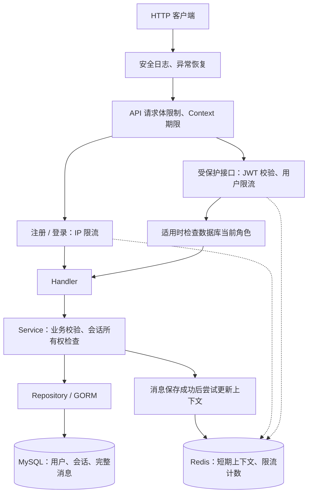

# Bilibili 规则智能客服学习项目

基于 Bilibili 公开规则资料规划的个人学习项目，非官方客服服务。

当前完成：用户认证、Redis 和基础安全能力。
Agent、RAG、Kafka、前端和 Kubernetes 尚未实现。

## 当前技术栈

Go、Gin、GORM、MySQL、Redis、bcrypt、JWT、Zap、Docker Compose。

## 已实现功能

- 用户注册、登录，使用 bcrypt 保存密码哈希。
- JWT 签发、校验和 Gin 认证中间件。
- 当前用户查询。
- 普通用户、客服、管理员的简单角色判断。
- 会话创建、查询及消息写入、历史查询。
- 会话归属使用 JWT 身份，并校验所有权。
- MySQL 保存完整消息历史。
- Redis 保存短期上下文：最多 20 条，追加后刷新 30 分钟 TTL。
- Redis 按用户 ID 限流：从首次请求开始的 60 秒窗口内允许 60 次。
- 认证、授权、缓存、限流测试及 MySQL 集成测试。
- 注册、登录共享基于客户端 IP 的限流：60 秒窗口内允许 10 次请求。
- API 请求体读取上限为 64 KiB。
- 请求 Context 截止时间、HTTP 连接超时和优雅关闭。
- 使用安全访问日志与异常恢复中间件，关闭 GORM 原始 SQL 日志。

角色验证接口只返回当前用户信息，不包含客服坐席或管理业务。
客服和管理员不会自动获得访问他人会话的权限。

## 本地启动

### 启动基础设施

首次配置时复制 `.env.example` 为 `.env`，填写本地密码。
已有 `.env` 时不要直接覆盖。

```powershell
docker compose up -d mysql redis
docker compose ps
docker compose exec -T redis redis-cli PING
```

预期 Redis 返回 `PONG`。

### 配置 Go 进程环境变量

```text
DB_HOST=127.0.0.1
DB_PORT=3307
DB_USER=bili_app
DB_PASSWORD=本地数据库应用密码
DB_NAME=bili_support

REDIS_ADDR=127.0.0.1:6379
REDIS_PASSWORD=

JWT_SECRET=本地生成的随机密钥
JWT_ISSUER=bili-support
JWT_TTL=2h
```

JWT_SECRET 必须使用随机密钥，当前代码要求至少 32 字节。
不要提交真实密码、JWT 密钥或 Token。

Docker Compose 会读取 `.env`，Go 程序不会自动加载该文件。

- 使用 GoLand 运行按钮：配置对应 Run Configuration 的环境变量。
- 使用 Terminal 执行 go run：在同一个终端设置环境变量。
- GoLand 运行配置不会自动应用到 Terminal 命令。

当前本地 Redis 未启用密码，因此 REDIS_PASSWORD 留空。

### 迁移与启动

在项目根目录、环境变量已配置的终端执行：

```powershell
go run ./cmd/migrate
go run ./cmd/api
```

现有 API 进程需要先停止，再启动新版本。

```text
GET http://127.0.0.1:8080/health
```

当前健康检查只表示 HTTP 服务可响应，不检查所有依赖的实时状态。

## API 文档

详见 [docs/api.md](docs/api.md)。

受保护请求使用：

```text
Authorization: Bearer <access_token>
```

创建会话只提交标题：

```json
{"title":"账号申诉咨询"}
```

会话归属来自 JWT，不能通过请求体中的 user_id 指定。

## 当前架构



健康检查直接返回 HTTP 服务状态，不经过上述 API 认证与限流链路。

## 数据职责

| 组件 | 用途 |
|---|---|
| MySQL | 用户、角色、会话、完整消息历史 |
| Redis | 短期上下文、限流计数 |

上下文键：`conversation:context:{conversationID}`。
限流键：`ratelimit:user:{userID}`。
认证限流键：`ratelimit:auth:ip:{IP}`。
注册与登录共享同一个 IP 的额度，与用户 ID 限流额度相互独立。

Redis 上下文是可丢失的副本，不能替代 MySQL 历史。
历史查询始终读取 MySQL，当前尚未实现分页。
缓存缺失时不会自动恢复旧上下文，后续消息会重新创建缓存。
上下文列表按追加到 Redis 的顺序排列。

## 请求处理与故障策略

所有请求先经过安全访问日志和异常恢复中间件。

`/api/v1` 下的请求还经过请求体限制和请求 Context 截止时间设置：

- 注册、登录：IP 限流 → Handler → Service。
- 受保护接口：JWT 认证 → 用户 ID 限流 → 角色判断（适用时）→ Handler → Service。

会话与消息操作还需在 Service 中校验所有权。
当前直接访问 API，不信任客户端传入的代理转发头。

中间件按注册顺序进入，调用 c.Next() 后再按相反顺序返回。
拒绝请求时使用 Abort 阻止后续处理，并使用 return 结束当前函数。

请求 Context 期限为 5 秒，用于取消支持 Context 的下游操作。
它不能强制中断 bcrypt 运算，也不保证所有超时都返回 504。
业务错误处理中识别到 context.DeadlineExceeded 时返回 504；
Redis 限流检查失败仍返回 503。

HTTP Server 设置连接读写超时。
服务收到退出信号后停止接收新连接，最多等待 10 秒进行优雅关闭，
随后释放 Redis 客户端、MySQL 连接池及日志资源。

## 测试

普通测试使用 Stub 和 miniredis，不要求真实 MySQL、Redis。
未启用集成测试时执行：

```powershell
go test ./... -count=1
go vet ./...
```

MySQL 集成测试需要已准备好的独立数据库 `bili_support_test`
及相应权限。在专用终端设置连接参数后执行：

```powershell
$env:RUN_MYSQL_TESTS="1"
$env:DB_NAME="bili_support_test"

go test ./internal/repository -run 'Test.*MySQL$' -v -count=1

Remove-Item Env:RUN_MYSQL_TESTS
$env:DB_NAME="bili_support"
```

集成测试中的测试记录通过事务回滚清理；
表结构迁移和自增序列变化不属于记录回滚保证。
不得在业务数据库运行集成测试。

## 当前已验证的场景

- 注册、重复用户名、密码哈希及真实登录。
- 缺少或无效 Token 被拒绝。
- /me 返回数据库当前用户信息。
- 两个用户的会话和消息隔离。
- Redis 最近 20 条窗口、TTL、缓存删除后历史仍完整。
- 上下文更新失败时保留已保存消息。
- 用户限流、用户间额度隔离、窗口恢复及 Redis 故障拒绝。
- 三种角色的访问差异，以及同一个 Token 下角色降级生效。

## 当前限制

- 没有 Token 刷新、主动注销撤销机制。
- 注册和登录已有基础 IP 限流，但不能防御分布式暴力破解；同一 NAT 网络的用户共享额度。
- 固定窗口限流允许窗口交界处出现突发请求。
- Redis 与 MySQL 不保证强一致，没有缓存补偿机制。
- 消息提交尚无请求幂等机制。
- 角色变更影响后续检查，不会撤销已经通过检查的在途请求。
- 未接 Casbin、Agent、RAG、Kafka、Kubernetes。
- 当前配置数值属于功能约束，尚无性能压测结果，不能作为 QPS 或延迟指标。