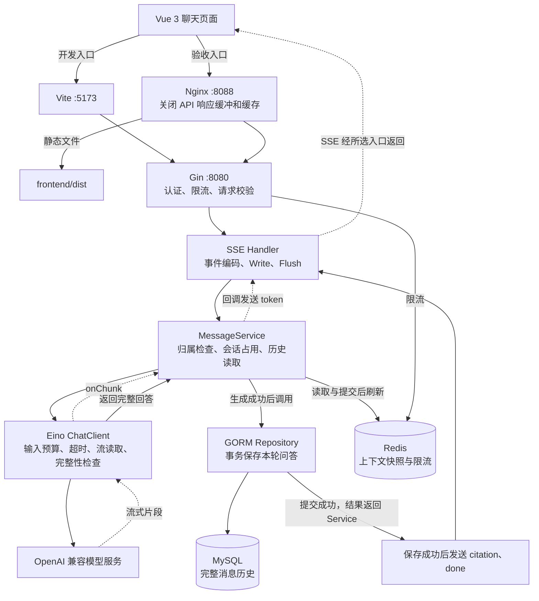
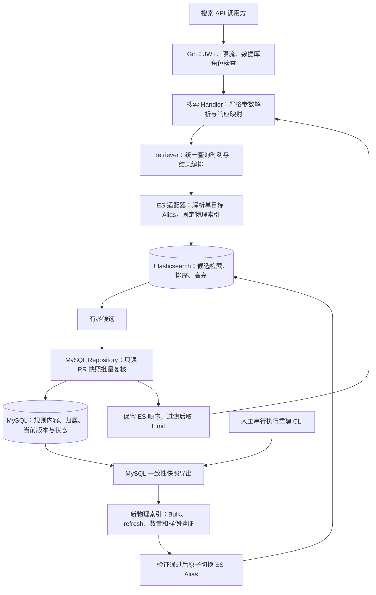

# Bilibili 规则智能客服学习项目

基于 Bilibili 公开规则资料规划的个人学习项目，非官方客服服务。

当前完成用户认证、会话与消息管理、Redis 缓存与限流、
Vue 3 客服前端、Nginx 代理，以及基于 Eino 的普通与 SSE 流式模型问答。

模型调用前读取最近历史，成功后通过 MySQL 事务保存用户消息和模型回答，
再读取已提交的最近消息，整体更新 Redis 上下文快照。

当前已有模型问答、SSE 流式输出、独立规则知识库后端及规则搜索 API。
知识库支持草稿、来源核验、发布、版本切换、历史追溯和下线；
搜索采用 Elasticsearch 片段级索引，并由 MySQL 批量复核候选的当前状态。
支持正文关键词、标题加权、章节检索、条款编号精确查询、分类过滤、
当前有效版本过滤和高亮。

规则搜索尚未接入聊天回答，也没有独立搜索前端。
尚未实现 RAG、工具调用、Milvus、混合检索、Kafka 或 Kubernetes。

项目不是 Bilibili 官方客服，不能查询真实账号或办理申诉。

## 当前技术栈

Go、Gin、GORM、MySQL、Redis、bcrypt、JWT、Zap、Docker Compose。
Vue 3、TypeScript、Vite、Vue Router、Pinia、Axios、Element Plus、Nginx。
Eino、Eino OpenAI 兼容模型适配器。
Elasticsearch 8.19.0，通过 HTTP API 使用，采用独立 Docker Compose 项目部署。

## 已实现功能

- 用户注册、登录，使用 bcrypt 保存密码哈希。
- JWT 签发、校验和 Gin 认证中间件。
- 当前用户查询。
- 普通用户、客服、管理员的简单角色判断。
- 会话创建、查询及消息写入、历史查询。
- 会话归属使用 JWT 身份，并校验所有权。
- MySQL 保存完整消息历史。
- Redis 保存最多 20 条最近消息，成功替换快照后刷新 30 分钟 TTL。
- Redis 按用户 ID 限流：从首次请求开始的 60 秒窗口内允许 60 次。
- 认证、授权、缓存、限流测试及 MySQL 集成测试。
- 注册、登录共享基于客户端 IP 的限流：60 秒窗口内允许 10 次请求。
- API 请求体读取上限为 64 KiB。
- 请求 Context 截止时间、HTTP 连接超时和优雅关闭。
- 使用安全访问日志与异常恢复中间件，关闭 GORM 原始 SQL 日志。
- 前端登录、登录状态恢复、路由保护和退出登录。
- 当前用户会话列表、新建会话与会话切换。
- 消息历史、消息发送、加载状态与错误提示。
- 模型生成成功后，用户消息与模型回答在同一个 MySQL 事务中保存。
- Nginx 托管 Vue 构建产物，并代理 /api 请求到 Gin。
- Eino 流式读取，通过 Gin SSE 推送模型回答。
- start、token、citation、error、done 五类流式事件。
- Vue 使用 Fetch 读取响应流，支持生成状态、主动停止和会话切换取消。
- 流式回答完整生成后，通过 MySQL 事务保存本轮问答。
- Nginx 关闭 API 响应缓冲与缓存，支持 SSE 转发。
- MySQL 当前有效规则片段的一致性快照导出。
- Elasticsearch 全量重建、逐项 Bulk 结果检查、发布前验证和单目标 Alias 切换。
- 统一 Retriever 接口及受认证、限流、数据库角色检查保护的规则搜索 API。
- ES 候选经 MySQL 批量复核后返回；无命中与依赖故障分别处理。
- 搜索结果携带规则来源、版本、条款与片段身份，以及可选高亮。

角色验证接口仅返回当前用户信息；知识库管理接口另设在管理员路由下。
客服和管理员不会自动获得访问他人会话的权限。

## 本地启动

### 启动基础设施

首次配置时复制 `.env.example` 为 `.env`，填写本地密码。
已有 `.env` 时不要直接覆盖。

```powershell
docker compose up -d mysql redis
docker compose ps
docker compose exec -T redis redis-cli PING
```

预期 Redis 返回 `PONG`。

### 配置 Go 进程环境变量

```text
DB_HOST=127.0.0.1
DB_PORT=3307
DB_USER=bili_app
DB_PASSWORD=本地数据库应用密码
DB_NAME=bili_support

REDIS_ADDR=127.0.0.1:6379
REDIS_PASSWORD=

JWT_SECRET=本地生成的随机密钥
JWT_ISSUER=bili-support
JWT_TTL=2h
```

JWT_SECRET 必须使用随机密钥，当前代码要求至少 32 字节。
不要提交真实密码、JWT 密钥或 Token。

Docker Compose 会读取 `.env`，Go 程序不会自动加载该文件。

- 使用 GoLand 运行按钮：配置对应 Run Configuration 的环境变量。
- 使用 Terminal 执行 go run：在同一个终端设置环境变量。
- GoLand 运行配置不会自动应用到 Terminal 命令。

当前本地 Redis 未启用密码，因此 REDIS_PASSWORD 留空。

### 模型配置

在 GoLand 的 API Run Configuration 中增加：

| 变量 | 说明 |
|---|---|
| LLM_BASE_URL | OpenAI 兼容接口基础地址 |
| LLM_MODEL | 模型名称，当前使用 qwen-plus |
| LLM_API_KEY | 仅保存在本地的模型凭证 |
| LLM_TIMEOUT | 模型超时，例如 30s；API 启动要求大于 0 且不超过 30s |

Go 程序不会自动加载根目录 `.env`。
GoLand 运行配置中的环境变量也不会自动传入 Terminal 命令。

模型客户端初始化成功不代表密钥有效或接口可达，
需要通过一次真实问答验证。

真实 Key 不写入源码、前端 VITE_* 变量、示例文件或共享运行配置。
不要输出完整 LLM 配置或 Authorization 请求头。

普通单元测试使用模型替身，不依赖真实 Key，不产生模型调用费用。
当前未提供可直接启动整个 API 的 Mock 模型模式。

模型失败时返回明确错误，不自动重试，也不降级为固定演示回复。

### 迁移与启动

在项目根目录、环境变量已配置的终端执行：

```powershell
go run ./cmd/migrate
go run ./cmd/api
```

现有 API 进程需要先停止，再启动新版本。

```text
GET http://127.0.0.1:8080/health
```

当前健康检查只表示 HTTP 服务可响应，不检查所有依赖的实时状态。

## 前端开发与 Nginx 联调

前端使用 Node.js 24 LTS。以下命令均在项目根目录执行。

先按照“本地启动”配置 MySQL、Redis 和 Go 进程环境变量，
通过 GoLand 启动 cmd/api，确认：

http://127.0.0.1:8080/health

### 开发模式

首次安装依赖，或依赖锁文件更新后执行：

```powershell
npm --prefix frontend ci
```

启动 Vite：

```powershell
npm --prefix frontend run dev
```

浏览器访问 http://127.0.0.1:5173。

Vite 提供开发页面和热更新，将 /api 请求转发到
http://127.0.0.1:8080，并保留原始请求路径。

### Nginx 构建验收模式

```powershell
npm --prefix frontend run build
docker compose up -d nginx
docker compose exec nginx nginx -t
```

浏览器访问 http://127.0.0.1:8088。

Nginx 通过只读挂载提供 frontend/dist 中的静态文件，
将 /api 请求转发到 host.docker.internal:8080。
该地址适用于当前 Docker Desktop 环境下访问宿主机 Gin。

Gin 仍由 GoLand 启动；Compose 管理 MySQL、Redis 和 Nginx。
当前不是整个应用的一键容器化部署。

Nginx 模式不依赖 Vite 进程。
修改前端源码后，需要重新构建并刷新浏览器。

### 修改配置后

修改 Nginx 配置：

```powershell
docker compose exec nginx nginx -t
docker compose exec nginx nginx -s reload
```

修改 Go 代码后，需要在 GoLand 中停止并重新运行 API。
执行 go test 不会更新正在运行的 API 进程。

### 登录状态

Token 保存于 sessionStorage，Pinia 保存当前页面中的认证状态。
刷新页面后通过 /api/v1/me 验证身份并恢复用户信息。
不保存密码。

5173 与 8088 属于不同来源，登录存储不共享，需要分别登录。
退出登录清除浏览器本地状态，不撤销后端已签发的 Token。

### 常见问题

| 现象 | 排查方向 |
|---|---|
| Missing script: build | 在根目录使用 npm --prefix frontend run build |
| 首页 500，日志提示内部跳转循环 | 检查 root 路径与 index.html 是否存在 |
| Nginx 返回 HTML 502 | 检查 Gin 是否启动及代理目标是否正确 |
| JSON 502、model_unavailable | 模型调用失败，检查模型配置、网络和服务可用性 |
| API 404 | 检查路径前缀；proxy_pass 目标末尾不添加斜杠 |
| 修改代码后行为未更新 | 重启 GoLand API，再发送一条新消息 |
| 刷新 /chat 出现 404 | 检查 Nginx 的 index.html 回退配置 |

查看日志：

```powershell
docker compose logs --tail=50 nginx
```


## API 文档

详见 [docs/api.md](docs/api.md)。

受保护请求使用：

```text
Authorization: Bearer <access_token>
```

创建会话只提交标题：

```json
{"title":"账号申诉咨询"}
```

会话归属来自 JWT，不能通过请求体中的 user_id 指定。

## SSE 流式聊天

### 请求与事件协议

接口：

```text
POST /api/v1/conversations/:id/messages/stream
Authorization: Bearer <access_token>
Content-Type: application/json
Accept: text/event-stream
```

请求体：

```json
{"content":"请介绍你可以提供的帮助"}
```

响应采用 UTF-8 编码，每个事件以空行结束：

```text
event: token
data: {"content":"你好"}
```

| 事件 | data 示例 | 含义 |
|---|---|---|
| start | `{"conversation_id":1}` | 开始本轮流式处理 |
| token | `{"content":"你好"}` | 新增文本片段，不保证对应单个字或单个模型 Token |
| citation | `{"items":[]}` | 引用信息；当前未实现 RAG，固定为空数组 |
| error | `{"code":"model_timeout","message":"模型响应超时，请稍后重试"}` | 本轮处理失败 |
| done | `{"user_message_id":10,"assistant_message_id":11}` | 本轮问答已成功提交 MySQL |

正常事件顺序为：

```text
start → token（零个或多个）→ citation → done
```

流开始前失败，返回 HTTP 错误状态和 JSON。
流开始后失败，通过 error 事件报告，不再发送 done；
客户端断开时，服务端可能无法继续发送任何事件。

HTTP 200 只表示流式响应已经开始，不代表回答生成或保存成功。
连接结束但未收到 done 时，应查询历史确认，不能自动重试提交。

### 前端读取方式

SSE 仍是 HTTP 响应，但服务端持续写入事件并及时 Flush，
客户端可以在响应结束前处理新增内容。

当前接口需要 POST JSON 和 Bearer 认证，因此前端使用
Fetch + ReadableStream + TextDecoder 读取 SSE，没有使用原生 EventSource。
当前客户端不提供断线重连或断点续传。

SSE 适合“客户端提交一次问题、服务端持续推送回答”的场景。
WebSocket 更适合需要持续双向通信的场景，例如实时语音和协同操作。

### 取消与保存边界

请求 Context 传递给 Service 和 Eino 模型调用。
客户端断开或主动停止后，支持 Context 的下游操作响应取消，
流式读取退出并关闭 reader。

Context 是协作式取消机制，不会强制终止任意阻塞代码，
也不保证远程模型平台停止推理或计费。

模型生成过程中失败或取消，不保存本轮问答。
完整生成成功后，保存使用 context.WithoutCancel 派生的独立 Context，
并设置 3 秒超时。因此进入保存阶段后，即使客户端断开，
本轮问答仍可能成功保存。

done 仅在事务提交成功后发送。
停止接收不等于数据库回滚，应刷新历史确认最终结果。

回答先在内存中累积，完成后一次事务保存用户消息和助手消息。
不逐 Token 写数据库，以减少数据库往返、更新与锁开销，
并避免把尚未完整生成的回答当成正式历史记录。

当前流式实现要求模型结束原因为 stop。
输出达到长度上限等非正常结束情形会报告失败，不保存部分回答。

### Nginx 配置

/api/ 代理已配置：

```nginx
proxy_http_version 1.1;
proxy_set_header Connection "";
proxy_buffering off;
proxy_cache off;
gzip off;
proxy_ignore_client_abort off;
```

proxy_buffering 控制响应是否积攒后转发；
proxy_cache 控制响应是否缓存并复用，二者不同。

proxy_read_timeout 55s 是两次读取上游数据之间的等待超时，
不是整个响应的总时长限制。

修改配置后先执行 nginx -t，成功后再 reload。

### PowerShell 使用 curl 调试

前提：后端及 Nginx 已启动，已有登录 Token 和属于当前用户的会话。
在本机浏览器开发者工具的 Session Storage 中取得
bili_support_token；不要将真实 Token 写入文档或提交到仓库。

以下命令在项目根目录执行：

```powershell
$sseBaseURL = 'http://127.0.0.1:8088'
$sseConversationID = Read-Host '输入当前用户的会话 ID'
$sseToken = Read-Host '输入登录 Token'
$sseBodyPath = [System.IO.Path]::GetTempFileName()

try {
    [System.IO.File]::WriteAllText(
        $sseBodyPath,
        '{"content":"Please reply in three short paragraphs."}',
        [System.Text.UTF8Encoding]::new($false)
    )

    curl.exe --no-buffer --include `
        --request POST `
        "$sseBaseURL/api/v1/conversations/$sseConversationID/messages/stream" `
        --header "Authorization: Bearer $sseToken" `
        --header "Content-Type: application/json" `
        --header "Accept: text/event-stream" `
        --data-binary "@$sseBodyPath"
} finally {
    Remove-Item -LiteralPath $sseBodyPath -ErrorAction SilentlyContinue
    Remove-Variable sseToken -ErrorAction SilentlyContinue
}
```

--no-buffer（即 -N）关闭 curl 自身的输出缓冲，
--include（即 -i）显示 HTTP 响应头。

正常情况下可持续看到 start、token、citation、done。
输出阶段按 Ctrl+C 可以模拟客户端断开。

将 sseBaseURL 改为 http://127.0.0.1:8080，
可对比直连 Gin 与经过 Nginx 的行为。
每次执行都会发起新的聊天请求，不是回放已有回答。

若直连可以流式显示，而代理入口集中输出，
检查 Nginx 生效配置、是否已 reload，以及响应缓冲和压缩配置。

## 当前架构
以下为现有聊天与 SSE 链路：


规则搜索使用独立链路，目前不向聊天模型提供检索结果：



图中的 MySQL 读取分为两类：请求期复核候选，维护期导出重建快照。
它们不是同一个事务，也不与 ES 组成分布式事务。

健康检查只表示 HTTP 服务能够响应，不证明 ES、MySQL、
Redis 或模型服务均可用。

## 数据职责

| 组件 | 用途 |
|---|---|
| MySQL | 用户、角色、会话、完整消息历史，以及知识库文档、版本、原始条款、派生片段、分类、核验与操作记录 |
| Redis | 短期上下文、限流计数 |
| Elasticsearch | 从 MySQL 派生的规则片段索引，用于关键词召回、相关性排序和高亮；可以重建，不作为唯一事实来源 |

MySQL 保存已录入的规则内容、版本归属、当前版本指针、发布修订号及管理状态。
Elasticsearch 保存检索所需的展开副本，不能替代 MySQL 的版本管理和事务约束。

ES 索引丢失或 Mapping 需要调整时，可以从 MySQL 的当前有效规则重新构建。
重建不会恢复 MySQL 中不存在的内容，也不代表已经验证资料的官方真实性。
Redis 继续承担上下文缓存和限流，不保存规则事实。

上下文键：`conversation:context:{conversationID}`。
限流键：`ratelimit:user:{userID}`。
认证限流键：`ratelimit:auth:ip:{IP}`。
注册与登录共享同一个 IP 的额度，与用户 ID 限流额度相互独立。

Redis 上下文是可丢失的副本，不能替代 MySQL 历史。
GET 消息历史接口始终读取 MySQL，当前尚未实现分页，也不负责缓存回填。

模型调用前优先读取 Redis：
- 缓存非空时，查询 MySQL 中该会话的最新消息 ID。
- 缓存尾部 ID 与数据库最新 ID 相同且非零时，使用缓存历史。
- 缓存为空、读取失败或尾部 ID 不一致时，读取 MySQL 最近 20 条消息。
- 数据库最新 ID 校验失败时返回错误，不使用未经确认的缓存。

提供给模型的历史按消息 ID 升序排列。
缓存命中仍需一次数据库最新 ID 查询，不是完全绕过 MySQL。

本轮用户消息和模型回答通过事务一起保存。
事务提交后，重新查询最近 20 条消息，整体替换 Redis 快照，
成功后设置 30 分钟 TTL。缓存刷新失败不撤销已提交的消息。

最新 ID 校验只能检查缓存尾部是否跟上数据库，
不能识别尾部 ID 相同但中间消息缺失或内容被修改的情况。

## 会话并发与模型预算

当前 API 共享一个 MessageService。同一会话正在处理问答时，
另一个请求返回 HTTP 409、conversation_busy；不同会话可以分别处理。
占用保护在处理结束时释放，包括模型失败、超时和数据库保存失败。

这是单实例内的并发保护，不提供跨进程协调，也不等同于请求幂等。
客户端不自动重试消息提交，结果不确定时先查询历史。

模型输入限制：
- 最多读取最近 20 条历史消息。
- 系统 Prompt、历史和当前问题去除相应首尾空白后，
  正文总量不得超过 32 KiB（32768 个 UTF-8 字节）。
- 超限时从最旧一轮开始移除历史，保留最近的连续历史。
- 系统 Prompt 和当前问题完整保留；仅这两项就超限时，
  返回 model_input_too_large，不调用上游模型。
  普通接口返回 HTTP 400；当前流式接口的预算检查发生在 start 之后，
  因此通过 HTTP 200 响应中的 error 事件报告。
- 裁剪只影响本次模型输入，不删除 MySQL 或 Redis 中的历史。

32 KiB 是文本字节预算，不是精确 Token 数，也不包含 JSON 编码开销。
用户提交内容仍受 1～10000 个字符的独立限制。

模型请求设置 max_tokens=1024，要求上游限制输出 Token 数量。
达到输出上限时回答可能被截断，不能据此保证回答完整。
本地 HTTP 测试已验证该参数发出，当前服务端的实际兼容性在最终真实问答中确认。

## 请求处理与故障策略

所有请求先经过安全访问日志和异常恢复中间件。

`/api/v1` 下的请求还经过请求体限制和请求 Context 截止时间设置：

- 注册、登录：IP 限流 → Handler → Service。
- 受保护接口：JWT 认证 → 用户 ID 限流 → 角色判断（适用时）→ Handler → Service。

会话与消息操作还需在 Service 中校验所有权。
API 支持直接访问，也可经 Vite 或 Nginx 代理访问。
经代理访问时，认证 IP 限流可能按代理来源共享额度。
可信代理由 TRUSTED_PROXIES 配置，多个 IP/CIDR 使用逗号分隔。
默认为空，Gin 不信任转发头。

配置无效或为全网 /0 时拒绝启动。
仅能填写已验证的代理地址或专用可信网段。

当前 Docker Desktop 本地联调未配置可信代理，
认证 IP 限流仍可能按代理来源共享额度。

中间件按注册顺序进入，调用 c.Next() 后再按相反顺序返回。
拒绝请求时使用 Abort 阻止后续处理，并使用 return 结束当前函数。

请求 Context 期限为 40 秒，用于取消支持 Context 的下游操作。
它不能强制中断 bcrypt 运算，也不保证所有超时都返回 504。
业务错误处理中识别到 context.DeadlineExceeded 时，
若响应尚未开始则返回 504；SSE 已开始时通过 error 事件报告。
Redis 限流检查失败仍返回 503。
模型调用最多等待 30 秒；API 请求 Context 为 40 秒；
HTTP Server WriteTimeout 为 50 秒；
Nginx proxy_read_timeout 为 55 秒；
普通 Axios 请求 timeout 为 60 秒；
Fetch 流式请求通过 AbortSignal.timeout 设置 60 秒总超时。
SSE 开始后的业务错误通过 error 事件报告，不能再修改 HTTP 状态码。

这些配置的计时语义不同，不等同于统一的总请求时限。
请求取消通过 Context 传递，不保证已经提交的数据库操作回滚。

HTTP Server 设置连接读写超时。
服务收到退出信号后停止接收新连接，最多等待 60 秒让在途请求完成。
超过期限时强制关闭 HTTP 连接，再释放 Redis 客户端、MySQL 连接池及日志资源。
正常等待和关闭超时路径已有本地 HTTP 测试。
外部强制终止或不响应 Context 的操作不在完整结束保证之内。

## 日志与取消说明

Go 访问日志不记录 Token、密码、请求正文和查询参数。

Nginx 自定义访问日志仅记录方法、状态、大小和耗时。
Nginx 内置错误日志仍可能包含请求 URI，不能将凭证或正文放入 URL。

前端离开页面或切换会话时取消不再需要的请求；
旧认证版本的响应不能清除新登录状态。

取消请求不代表服务器操作已回滚。
创建会话和发送消息不自动重试，结果不确定时先查询历史。

普通模型调用在失败时记录固定日志文本和 error_kind，
不记录供应商原始错误正文或完整模型配置。

流式调用分别记录模型阶段和 Service 处理阶段的结束结果：

| 日志 | 字段 | 含义 |
|---|---|---|
| model stream failed | error_kind | 上游错误分类，例如认证、限流或网络错误 |
| model stream finished | outcome、duration | 模型流式处理的最终结果和耗时 |
| chat stream finished | stage、outcome、saved、duration | Service 结束阶段、结果及是否确认保存成功 |

模型阶段正常返回时，输出一条 model stream finished。
上游调用失败时可能额外输出一条 model stream failed，
两条日志分别描述失败原因与阶段结果。

常见 Service 日志结果：

| 场景 | stage | outcome | saved |
|---|---|---|---|
| 正常保存 | completed | success | true |
| 模型超时 | generate | timeout | false |
| 生成阶段响应取消 | generate | canceled | false |
| 生成阶段回调写入失败 | generate | failed | false |
| 数据库保存返回错误 | save | failed 或 timeout | false |
| 缓存刷新失败，但保存成功 | completed | success | true |

具体 outcome 依据最终返回错误分类。
客户端断开可能表现为 Context 取消，也可能先表现为网络写入错误，
不能只通过 canceled 分类判断是否正确退出。

缓存刷新失败另有警告日志，不撤销已提交的消息。
saved=true 表示 Service 已确认事务提交成功，
不代表客户端一定收到了 done。

saved=false 表示应用未确认保存成功；
数据库提交过程中发生连接异常时，仍可能存在结果不确定的情况，
应查询历史确认，不能自动重试提交。

duration 是对应调用阶段的经过时间，不是首段输出延迟，
也不是点击停止到资源释放的时间。

结束日志在正常返回路径通过 defer 输出。
若发生 panic，由恢复中间件记录；当前结束日志分类不用于判定 panic 结果。

日志不记录用户问题、模型回答、密码、Token、Key 或供应商原始错误正文。

本地 HTTP 测试验证请求取消能传递到 Eino 适配器及 HTTP 连接。
这不代表远端模型平台一定停止推理或停止计费。

## 测试

前端测试与构建：

```powershell
npm --prefix frontend run test
npm --prefix frontend run build
```

当前测试覆盖包括：

- 模型流读取、结束原因、取消、超时和 reader 关闭。
- Service 完整回答保存、保存阶段取消边界及缓存刷新失败。
- 模型与 Service 结束日志分类、字段白名单和脱敏。
- SSE Handler 的 Write、Flush 失败和客户端断开。
- 基于 net.Pipe 和真实 http.Server 的慢客户端写超时。
- Vue 流式显示、停止、切换会话、过期回调、历史同步失败恢复和卸载取消。

页面测试模拟 API 返回，不依赖真实模型或数据库。
慢客户端测试使用缩短的测试写超时，不代表生产环境具有相同退出耗时。
本地 HTTP、组件测试和数据库集成测试不能替代完整 Nginx 链路验收。

真实链路调试方法见“SSE 流式聊天”章节。

部分单元测试使用 Stub 和 miniredis，不需要真实基础设施。
但当前 router 包包含要求显式隔离配置的知识库 MySQL 测试，
缺少配置时部分测试会失败，不能把 go test ./... 当作无数据库的默认入口。

知识库 Service 与 Handler 的局部检查：

```powershell
go test ./internal/service ./internal/handler -run '^TestKnowledge' -count=1 -v
```

该命令不覆盖真实路由、MySQL 事务、锁或并发。

真实 MySQL 验收要求预先准备独立 bili_support_test，
确认连接账号、目标实例、InnoDB 表结构及隔离条件，
并停止其他测试与演示写入。
连接密码只通过本机环境配置。

在专用终端明确设置：

```powershell
$env:RUN_MYSQL_TESTS = "1"
$env:DB_NAME = "bili_support_test"
```

先执行只读身份预检：

```powershell
go test ./internal/router -run '^TestKnowledgeMySQLPreflight$' -count=1 -v
```

核对输出确实是预期测试实例后，
将该实例 UUID 配置到 TEST_MYSQL_SERVER_UUID。
确认其他写入者已停止后设置 TEST_ISOLATED=1；
环境变量声明本身不能证明隔离已经完成。

完成上述条件后，知识库回归入口为：

```powershell
go test ./internal/service ./internal/handler ./internal/router -run '^TestKnowledge' -p 1 -count=1 -timeout=300s -v
```

发布、切换和下线夹具进一步核对实例 UUID，
并使用独立连接验证真实事务和竞争。
测试库元数据检查不能替代账号权限与外部隔离确认。

知识库测试含实际提交和定向夹具清理，
不能统称为“全部通过外层事务回滚清理”。
DDL、自增序列以及故障清理失败不属于记录回滚保证。
不得在业务数据库运行集成测试。

最终验收还需覆盖既有认证和聊天后端回归，
不能只运行 TestKnowledge。
完整执行范围、退出码、失败、跳过项和脱敏日志在 D07-S06-R04 记录。
未运行、环境阻塞或关键用例跳过均不能记作验收通过。

## 当前已验证的场景

- 注册、重复用户名、密码哈希及真实登录。
- 缺少或无效 Token 被拒绝。
- /me 返回数据库当前用户信息。
- 两个用户的会话和消息隔离。
- Redis 最近 20 条窗口、TTL、缓存删除后历史仍完整。
- 上下文更新失败时保留已保存消息。
- 用户限流、用户间额度隔离、窗口恢复及 Redis 故障拒绝。
- 三种角色的访问差异，以及同一个 Token 下角色降级生效。
- 缓存尾部 ID 校验、陈旧缓存回源，以及校验失败的错误处理。
- 同一会话并发拒绝与成功、失败后的占用释放。
- 优雅关闭等待在途请求，以及超时后的连接关闭。
- 模型错误分类与日志脱敏。
- 真实 Eino 适配器对本地 HTTP 服务的成功响应、401 和取消传递。
- 模型请求携带 max_tokens=1024。
- 输入预算边界、按轮裁剪、超限不调用模型及 HTTP 错误映射。
- MySQL 最新消息 ID、最近消息排序、数量边界和会话隔离。

以上新增场景由自动化测试覆盖；
最终版本的真实模型两轮问答与密钥核验结果另行记录。

## 当前限制

- 没有 Token 刷新、主动注销撤销机制。
- 注册和登录已有基础 IP 限流，但不能防御分布式暴力破解；同一 NAT 网络的用户共享额度。
- 固定窗口限流允许窗口交界处出现突发请求。
- Redis 与 MySQL 不保证强一致，没有缓存补偿机制。
- 消息提交尚无请求幂等机制。
- 角色变更影响后续检查，不会撤销已经通过检查的在途请求。
- 未接 Casbin、Agent、RAG、Kafka、Kubernetes。
- 尚无正式性能压测结果。超时配置属于功能约束，不能作为 QPS、首段延迟、取消耗时或并发容量指标。
- 当前日志提供模型阶段与 Service 阶段耗时，尚未形成首段延迟、取消传播耗时及业务成功率的指标统计。
- 模型调用成功后数据库仍可能保存失败；模型费用无法随数据库失败回滚。
- 优雅关闭最多等待 60 秒；超时后强制关闭连接。
- 外部强制终止或不响应 Context 的操作仍可能导致请求无法完整结束。

## Elasticsearch 规则检索

### 索引粒度、Mapping 与 Alias

一个 ES 文档对应一个 KnowledgeChunk，ES `_id` 使用片段 ID 的规范十进制字符串。
索引展开保存所属文档、版本、条款、分类、标题、章节、正文、来源及有效期。
当前知识库写入逻辑每条条款生成一个片段，chunk_index=0；
片段级索引设计不表示已经实现长条款的多片段切分。

Mapping 定义字段如何保存和检索：
- title、section_path、content 使用 text 类型和内置 cjk 分析器。
- ID、发布修订号、条款编号采用 keyword，使用精确匹配。
- 顺序字段采用 long，日期使用约定的 UTC 毫秒格式。
- version、source_url 保留原值，但不用于检索。
- dynamic=strict 拒绝未知字段；必填与关联完整性仍由应用校验。

物理 Index 保存一版完整检索数据；名称中的 v1 表示 Mapping 版本，
不表示官方规则版本。

Alias 提供稳定的查询名称。应用要求其只指向一个物理索引，
解析后固定该目标执行本次搜索，避免一次请求混用两个索引。
Alias 设置 is_write_index=false，用于避免经该别名误写，
但这不是访问控制，不能阻止直接写物理索引。

### 倒排索引与中文分析

倒排索引记录“词项出现在哪些文档中”，并保存评分需要的信息。
查询文本经过分析后，ES 根据词项找到候选，不需要像普通字符串扫描一样
逐条检查全部正文。

本项目使用内置 cjk 分析器，主要通过相邻 CJK 字符组合形成词项，
无需安装外部分词插件。它不是中文词典理解或语义检索：
专有名词、单字和中英文混排的效果需要用实际资料验证。

条款编号使用 keyword 精确匹配，不经过正文分词，
不将汉字数字、阿拉伯数字或内部顺序号自动互换。

### BM25 与标题加权

BM25 综合考虑：
- 词频：出现次数增加通常有帮助，但收益逐渐饱和。
- 逆文档频率：在索引中越少见的词，通常越有区分力。
- 字段长度：对文本长短进行归一化，避免长文本仅因字多就占优势。

自由文本使用 multi_match，字段权重为：
title^3、section_path^2、content，采用 best_fields 和 operator=or。
标题权重会影响相关性，但不保证所有标题命中都排在正文命中之前。

显式章节条件采用 match 过滤，条款编号、分类和文档 ID 使用 term 过滤；
各类条件组合为 AND。自由文本内部采用 OR，不代表不同筛选条件之间也是 OR。

结果按相关性分数降序排列，同分时按 chunk_id 字符串升序排列。
该顺序不是条款自然顺序，分数也不是概率、可信度或跨查询可比较的质量指标。

### 当前有效性与召回边界

每次搜索生成一个 UTC 毫秒查询时刻，ES 过滤与 MySQL 复核共用该时刻。
当前有效要求版本由文档当前指针选中、真实归属于该文档、已经发布、
未下线、生效时间不晚于查询时刻，并且失效时间为空或晚于查询时刻。

ES 先返回 Limit×5 个候选，最多 250 个。
MySQL 在一个只读 REPEATABLE READ 事务中批量复核真实归属、当前指针、
发布修订号、状态和时间。服务保留通过复核候选的 ES 顺序，再取 Limit 条。

陈旧候选被剔除后，结果可以少于 Limit，甚至为空。
当前不补搜、不分页，不提供全部有效命中的总数；响应 count 仅表示本次返回条数。

MySQL 复核依赖发布后内容冻结的约定，检查身份、归属、修订号和当前状态，
不逐字比较 ES 正文与 MySQL 正文，因此不是索引内容完整性审计。

### 重建与一致性限制

重建从 MySQL 一致性快照导出当前有效片段，写入新的物理索引，
逐项检查 Bulk 结果，执行 refresh、数量和样例验证后，再原子切换 ES Alias。
旧索引保留，不自动删除；重建由维护者串行执行，没有跨进程分布式锁。

Alias 原子切换只发生在 ES 内部，不构成 ES 与 MySQL 的事务。
发布、版本切换或下线后需要维护者重建索引，当前没有自动同步或 CDC。

如果重建期间 MySQL 切换了版本，搜索复核可以剔除旧版候选，
但无法召回尚未进入 ES 的新版内容。共用查询时刻也不代表两个存储共享快照；
MySQL 的有效性保证限于复核读取快照，响应后仍可能发生管理变更。

### 高亮、安全和运行边界

高亮单独放在 highlights 中，不覆盖原始正文。
ES 使用 HTML 编码和固定 em 标签；后续前端接入时仍需只允许受控标记，
不能把任意返回字符串作为可信 HTML。

正文最多返回 3 段、目标长度 160 字符；章节最多 2 段、目标长度 120 字符；
标题可以完整返回。目标片段长度不是严格字节上限，响应仍受整体大小预算约束。

无命中是成功的空结果；ES 故障、索引未就绪、非法后端响应、
超时和 MySQL 复核失败返回明确错误，不将故障伪装成空结果。

ES 使用独立 Compose 项目，本地模式关闭认证与 TLS，仅绑定回环地址。
这不是可直接对外部署的安全配置。
当前没有正式搜索吞吐量、延迟、召回率或排序质量测量结论。

### 本地部署与进程配置

ES 使用独立 Compose 项目 go-ai-agent-es，不随原 MySQL/Redis 项目自动启动。
以下命令在项目根目录执行；已运行的环境无需重复初始化索引。

```powershell
docker compose -f compose.elasticsearch.yaml up -d elasticsearch
docker compose -f compose.elasticsearch.yaml ps

Invoke-RestMethod 'http://127.0.0.1:9200/_cluster/health?wait_for_status=green&timeout=10s'
Invoke-RestMethod 'http://127.0.0.1:9200/_alias/rule_chunks_current'
```

检查健康响应的 timed_out 为 false、status 为 green。
健康正常不代表 Alias 已建立，也不代表索引已有规则。

ES 使用命名卷保存数据。日常停止使用 stop，不通过删除数据卷排查普通故障。
单节点、一个主分片、零副本的配置用于本地学习，不提供节点故障冗余。

API 和重建 CLI 分别读取各自进程的环境变量：

| 变量 | 默认值 | 用途 |
|---|---|---|
| ES_URL | http://127.0.0.1:9200 | ES 根地址，不包含凭据、查询参数或路径前缀 |
| ES_INDEX_ALIAS | rule_chunks_current | 已建立的单目标查询别名 |
| ES_TIMEOUT | 5s | 每次 ES HTTP 请求超时，必须为正时长 |

Go 程序不会自动加载 .env，GoLand Run Configuration 与终端环境不自动互通。
本地 API 运行在宿主机时可以使用上述回环地址；容器内的回环地址指向容器自身，
不能直接照搬宿主机配置。

API 仍需原有 MySQL、Redis、JWT 和模型配置。
ES 客户端初始化只校验配置，不执行健康探测、建索引或重建。
HTTP /health 正常不能代替搜索依赖检查。

全新环境可以先初始化空物理索引和 Alias，也可以通过完整重建首次发布。
当查询 Alias 不存在时，重建 CLI 会在新索引写入并验证成功后创建 Alias；
空快照仍默认拒绝，不能借首次发布绕过空结果保护。

已有 Alias 必须满足单目标、显式禁用别名写入等约束。
初始化请求材料包含已使用过的物理名称，不能原样重跑或覆盖已有资源。

### 全量重建操作

重建 CLI 只使用 MySQL 与 ES，不启动 HTTP、Redis、JWT 或模型客户端，
也不负责数据库迁移或规则录入。

执行前确认：

1. DB_HOST、DB_PORT、DB_USER、DB_PASSWORD、DB_NAME 指向预期源库。
2. 在独立确认的 MySQL 连接中读取源库名称和实例 UUID。
3. API 与 CLI 使用同一规则源库、ES 集群及 Alias。
4. 源库已有完成核验、发布且当前有效的规则；不存在其他并发重建或 Alias 维护。

可在已选定数据库的 SQL 控制台使用只读语句：

```sql
SELECT DATABASE() AS source_database, @@server_uuid AS source_server_uuid;
```

预期身份应来自维护者对连接目标的独立确认，
不能把 CLI 本次读出的实际身份自动填回预期参数来绕过检查。
口令仅放本地进程环境，不写入命令参数或日志。

CLI 参数：

| 参数 | 默认值 | 说明 |
|---|---|---|
| -expect-db | 必填 | 已独立核实的数据库名称 |
| -expect-server-uuid | 必填 | 已独立核实的 MySQL 实例 UUID |
| -mapping | deploy/elasticsearch/rule-chunks-v1.json | 新索引定义 |
| -timeout | 5m | 正常重建流程的总上下文超时 |
| -allow-empty | false | 显式允许发布空快照，默认禁止 |

以下为 PowerShell 运行模板。先在同一终端设置数据库与 ES 环境变量，
再填写独立核实的源身份；不要把占位符当作真实身份运行。

```powershell
& {
    $ErrorActionPreference = 'Stop'

    $expectedSourceDatabase = Read-Host '输入已独立核实的源库名'
    $expectedSourceUUID = Read-Host '输入已独立核实的 MySQL 实例 UUID'

    if ([string]::IsNullOrWhiteSpace($expectedSourceDatabase) -or
        $expectedSourceDatabase -ne $expectedSourceDatabase.Trim()) {
        throw '源库名不能为空或包含首尾空白。'
    }
    if ($expectedSourceUUID -notmatch '^[0-9a-fA-F]{8}-[0-9a-fA-F]{4}-[0-9a-fA-F]{4}-[0-9a-fA-F]{4}-[0-9a-fA-F]{12}$') {
        throw '实例 UUID 格式不正确。'
    }
    if ($env:DB_NAME -ne $expectedSourceDatabase) {
        throw '当前进程 DB_NAME 与已核实源库名不一致。'
    }

    New-Item -ItemType Directory -Force '.scratch/elasticsearch/evidence' | Out-Null

    go build -o .scratch/elasticsearch/reindex.exe ./cmd/reindex
    if ($LASTEXITCODE -ne 0) {
        throw 'CLI 构建失败，停止重建。'
    }

    $runID = [guid]::NewGuid().ToString('N')
    $reportPath = ".scratch/elasticsearch/evidence/reindex-$runID.jsonl"
    $errorPath = ".scratch/elasticsearch/evidence/reindex-$runID.stderr.log"

    & ./.scratch/elasticsearch/reindex.exe `
        -expect-db $expectedSourceDatabase `
        -expect-server-uuid $expectedSourceUUID `
        -timeout 5m 1> $reportPath 2> $errorPath
    $reindexExit = $LASTEXITCODE

    Set-Content -LiteralPath "$reportPath.exit.txt" -Value "EXIT_CODE=$reindexExit"
    Get-Content -LiteralPath $reportPath

    if ($reindexExit -ne 0) {
        throw '重建未完整成功。保留报告，先核对阶段和发布状态，不自动重试。'
    }
}
```

首次正常重建保持 -allow-empty 关闭。
空结果报错时先检查源库、发布状态和有效期；只有确实要发布空索引时才显式允许。

重建最多导出 10000 个片段，单文档 JSON 上限 1 MiB，总量上限 64 MiB。
Bulk 每批最多 500 条，同时受 4 MiB 实际请求字节预算限制；
超限失败，不静默截断。这些是资源保护边界，不是性能指标。

### 重建报告与故障处理

stdout 输出逐行 JSON，started 记录拟使用的新索引名称，
finished 记录阶段、结果、错误类别及退出码。
新名称在实际创建之前就会输出，不能仅凭名称认定索引已创建。

退出码 0 表示完整成功；1 表示执行、取消、超时、关闭资源或输出失败；
2 表示参数、本地配置或 Mapping 准备失败。

报告外层使用 stage、result 等小写字段；
result 内保留 Go 字段名，例如 DocumentCount、Publication，
发布状态读取 result.Publication.State。

| 发布状态 | 含义及处理 |
|---|---|
| not_attempted | 尚未尝试切换；可能已经留下新索引，按报告核对具体阶段 |
| applied | 已观察到发布生效；同时检查请求确认状态和退出码 |
| old_observed | 复核时仍为旧目标，不能排除原请求稍后生效；暂停进一步发布 |
| unknown | 无法可靠确定发布状态；保留资源并只读核对 |

非零退出不等于 Alias 必然未切换，例如发布后资源关闭或报告输出仍可能失败。
不要根据退出码自动回滚、删除索引或立即重试。

需要核对时，只读查询当前 Alias，并与报告中的 OldIndex、NewIndex 比较：

```powershell
Invoke-RestMethod "$($env:ES_URL)/_alias/$($env:ES_INDEX_ALIAS)"
```

该命令要求当前终端已显式设置 ES_URL 和 ES_INDEX_ALIAS。
固定实际物理目标后再检查其 Mapping、数量和样例。
数量一致不能单独证明全部正文正确，少量样例也不是全量内容校验。

发布异常后的只读恢复使用独立上下文，最多额外 5 秒；
总超时不是硬实时进程终止保证。
旧索引和失败索引不自动删除，清理前必须确认精确名称及引用关系。

### 搜索 API

请求方式：GET /api/v1/knowledge/search。
需要 Bearer Token，数据库当前角色允许 user、support、admin。
经过用户限流及角色检查后才进入搜索 Handler。

| 参数 | 规则 |
|---|---|
| q | 自由文本，去首尾空白后最多 200 个 Unicode 字符 |
| section | 章节文本，最多 500 个 Unicode 字符 |
| article_number | 原始条款编号精确匹配，最多 64 个 Unicode 字符 |
| document_id | uint64 规范十进制；省略或 0 表示不限 |
| category_id | uint64 规范十进制；省略或 0 表示不限 |
| limit | 省略或 0 使用 10；其他值为 1～50 |
| highlight | 仅接受 true 或 false；默认 false |

q、section、article_number 至少一个去空白后非空。
只有分类或文档 ID 不能单独发起搜索。
数字不接受负号、加号、前导零或显式空值；
文本必须为合法 UTF-8。中文和特殊字符需正确 URL 编码。

未知参数、重复参数、非法 URL 编码均拒绝。
没有历史搜索开关，也没有分页参数。

成功响应直接包含 items、count、limit，不额外包装 data。
无命中时，例如默认 Limit：

```json
{
  "items": [],
  "count": 0,
  "limit": 10
}
```

每个 item 包含：
- chunk_id、document_id、version_id、article_id、category_id；
- chunk_index、article_order；
- version、title、section_path、article_number、content、source_url；
- effective_at、expires_at、score、highlights。

ID 使用 JSON 数字，当前沿用 uint64 契约。
接入 JavaScript 客户端时须考虑超过安全整数范围的精度问题，
不能未经处理将大 ID 转为普通 Number。

expires_at 可以为 null；无高亮时 highlights 为 {}。
count 仅为当前返回条数，不能作为全部有效结果数量。

### 搜索错误与排查

| HTTP 状态 | code | 排查方向 |
|---|---|---|
| 400 | invalid_search_query | 参数名称、重复值、编码、字符上限、最低文本条件 |
| 401 | unauthorized | 登录凭据及用户是否仍存在 |
| 403 | forbidden | 数据库中的当前角色 |
| 429 | rate_limited | 用户限流额度 |
| 503 | rate_limit_unavailable | 限流依赖异常，请求尚未进入检索 |
| 503 | search_index_not_ready | Alias 缺失，或固定的物理目标在搜索时返回 404 |
| 503 | search_unavailable | ES 连接或可用性异常 |
| 503 | search_verification_failed | 候选的 MySQL 当前状态复核失败 |
| 502 | invalid_search_response | Alias 结构违反单目标等约束，或 ES 搜索响应结构、完整性、预算异常 |
| 502 | search_backend_rejected | ES 拒绝搜索请求 |
| 504 | request_timeout | 请求上下文超时 |
| 500 | internal_error | 内部契约、依赖组装或其他内部错误 |

错误响应为 code、message 两个字段，不返回原始 SQL、ES 响应或凭据。
角色检查阶段的数据库错误可能返回 500；
不能将所有 MySQL 故障统一描述为 search_verification_failed。

客户端取消后不保证还能收到 JSON 错误响应。
收到 200 空数组时再检查查询、当前有效版本与重建状态；
收到依赖错误时先恢复依赖，不将故障当作“没有规则”。

应用安全访问日志不记录搜索参数和令牌；
代理及客户端的日志策略仍须单独核对，不记录完整 Authorization。

## 规则知识库后端

本项目模拟智能客服的规则管理流程，不是 Bilibili 官方系统，
也不保证与官方产品的接口或管理方式一致。
知识库目前独立提供 HTTP 接口，尚未用于聊天回答。

知识库管理及当前、历史内容读取的调用路径为：
Gin Router → Handler → Service → GORM Repository → MySQL。

规则搜索另走 Retriever 链路，由 ES 召回候选，再由 MySQL 批量复核；
两类接口共享知识库领域数据，但不能互相绕过各自的校验。

Handler 处理身份、参数和响应映射；Service 处理业务输入与能力边界；
Repository 完成一致性读取、事务、锁和持久化。
MySQL 是知识库已录入内容及管理状态的权威数据源。
网页副本用于来源追溯，派生片段不替代原始条款。

### 五类核心模型及扩展记录

| 模型 | 职责与关系 |
|---|---|
| KnowledgeDocument | 保存稳定 document_key、当前版本指针和 publication_revision；一个文档有多个版本 |
| RuleVersion | 属于文档和一个分类；保存版本标识、标题、正文、来源、有效期、内容修订与管理状态 |
| RuleArticle | 属于版本；保存章节路径、真实条款编号、顺序和完整条文 |
| KnowledgeChunk | 属于条款；当前每条条款派生一个片段，chunk_index=0，不生成向量 |
| RuleCategory | 预置分类；当前包含账号管理、投稿审核、版权申诉、社区规范、弹幕规范 |

章节路径是条款字段，不单设章节表。没有官方条款编号时保留空编号，
不能把内部顺序号伪装成官方编号。分类 ID 取实际数据库值，不能猜测。

两类扩展记录：

- RuleVerification：保存核验人、核验时间、核验说明、依据 URL、
  被核验的内容修订号及录入内容快照。
- RuleOperation：保存发布或下线的操作者、操作时间、
  操作前后当前指针及发布修订号。

RuleVerification.ContentSnapshot 是系统生成的录入内容与条款快照，
不等于下载的官方网页副本；网页 HTML、PDF 等证据另行保留。
verified_at 是系统核验时间，不是资料取得时间。

### 时间与状态

有效期为左闭右开区间：

effective_at <= 查询时刻 < expires_at

expires_at 为空时不设置固定截止时间，但不表示规则永久有效。
effective_at 在草稿中允许为空，发布时必须非空、已到生效时刻且未过期。
published_at 是本系统发布时间，不替代来源规定的生效时间。

当前规则必须同时满足：

- 被文档 current_version_id 选中；
- 状态为 published，且未下线；
- 已生效且未过期。

当前查询只沿文档指针读取，不扫描旧版寻找替代结果。
下线清空指针；自然过期在查询时判断，不依赖定时任务，也不自动清空指针。
因此管理接口显示“有当前选择”不一定表示当前有有效规则。

没有当前有效规则时返回：
HTTP 404，code=knowledge_current_version_not_found。

这是合法业务结果，不是数据库异常。
数据库异常仍按内部错误处理，不能转换成“无有效规则”。

### 内容修订、发布修订与事务

content_revision 属于版本：
编辑草稿后递增，核验绑定实际内容修订。
编辑之后旧核验不再匹配，发布前必须重新核验。

publication_revision 属于文档：
首次发布、切换和下线成功后递增；
创建草稿、编辑和核验不推进它。

发布与下线携带 expected_publication_revision，
事务内按“文档 → 版本”顺序加锁，再检查归属、修订和操作条件。
当前选择、版本管理状态、发布修订号和操作记录在同一事务中更新。
版本切换复用 publish 接口，没有单独的 switch 接口。

过时请求返回 HTTP 409、knowledge_publication_conflict。
收到冲突后，应读取当前状态并判断是否继续，不能自动刷新修订号重试。
此修订号约束不等于请求幂等机制。

提交前失败回滚，不能留下部分更新。
提交阶段连接异常可能使客户端无法确定结果；
应查询状态确认，不能认定一定回滚或盲目重试。

当前及历史读取使用一致性快照。
响应描述该次读取观察到的状态，不保证响应到达客户端时状态仍未变化。

### 发布后冻结与历史引用

已发布内容不能通过草稿编辑接口覆盖，包括标题、正文、来源、
有效期、条款和分类归属。修改应创建新草稿版本。

新增版本区分：

- official：官方修订，要求修订依据 URL。
- editorial：知识库录入修订，不代表官方发布新版。

首次创建版本当前使用 unknown 修订类型，
不能仅凭项目版本字符串将其称为官方版本号。

历史引用使用 version_id 和 article_id，
不能只依赖当前指针、条款序号或新版条款 ID。

历史响应显示 is_current、is_superseded、is_expired、
is_withdrawn 和 is_current_effective。
被替代、过期、下线是不同事实，不应相互替代解释。

旧版被替代后保留；新版下线后也保留。
当前接口不提供旧版一键恢复。
已发布旧版不能直接重新发布，可参考其内容建立新草稿并重新核验。

### HTTP 接口与权限

下表路径均以 /api/v1 为前缀。

| 方法 | 路径 | 权限 / 用途 |
|---|---|---|
| POST | /auth/login | 登录，返回 Bearer Token |
| GET | /me | 登录用户查询自身身份 |
| POST | /admin/knowledge/documents | 管理员创建文档及首个草稿 |
| POST | /admin/knowledge/documents/:document_id/versions | 管理员创建新修订 |
| GET | /admin/knowledge/documents/:document_id | 管理员读取指针及发布修订号 |
| GET | /admin/knowledge/versions/:version_id | 管理员读取草稿及核验摘要 |
| PUT | /admin/knowledge/versions/:version_id | 管理员完整替换草稿内容 |
| POST | /admin/knowledge/versions/:version_id/verifications | 管理员核验指定内容修订 |
| POST | /admin/knowledge/documents/:document_id/publish | 管理员发布或切换当前版本 |
| POST | /admin/knowledge/documents/:document_id/withdraw | 管理员下线当前选择的版本 |
| GET | /knowledge/documents/:document_id/current | user/support/admin 查询当前有效规则 |
| GET | /knowledge/versions/:version_id | user/support/admin 查询已发布历史 |
| GET | /knowledge/versions/:version_id/articles/:article_id | user/support/admin 查询历史条款 |

未登录返回 401，无管理权限返回 403。
普通查询不开放草稿，不返回核验人等内部管理字段。
角色依据数据库当前身份检查，不仅依赖令牌签发时的状态。

当前没有分类管理后台、分类查询 HTTP 接口或操作记录列表 HTTP 接口。
核验摘要由管理员草稿详情返回；操作记录持久化及一致性由集成测试核对。

### 启动、迁移及请求限制

沿用前文的 MySQL、Redis、JWT 和 LLM 环境配置。
完整 API 启动仍初始化现有依赖；
知识库请求本身不调用模型，但当前没有独立的知识库启动模式。

go.mod 当前声明 Go 1.27.1。
数据库结构准备入口为 cmd/migrate，分类初始化入口为 cmd/seed，
API 入口为 cmd/api。

确认目标数据库及已有数据处理方案后，按需执行：

```powershell
go run ./cmd/migrate
go run ./cmd/seed
go run ./cmd/api
```

以上是操作说明，不代表需要每次演示重新迁移。
cmd/migrate 使用 AutoMigrate，不替代旧结构拆分、数据回填和迁移核对，
也不自动证明历史数据迁移正确。不能为重新演示删除用户或聊天数据。
cmd/seed 初始化分类，不创建管理员账号，也不录入规则正文。

/api/v1 请求体上限为 64 KiB，即 65536 字节；
包含 JSON 字段、转义及 content/articles 的重复内容，
不是只计算原始正文长度。超限返回 413、request_too_large。
请求 Context 期限为 40 秒，不能保证所有阻塞操作被强制中断。

健康检查仅证明 HTTP 服务可响应，不能证明测试库身份或完整依赖正常。

### 来源、模拟演示与数据隔离

来源采用人工核对，不自动抓取。
当前官方来源辅助校验只允许 www.bilibili.com 主机。
通过 URL 校验不能证明内容真实、完整或仍然适用。

完整模拟流程见 [knowledge-demo.http](docs/http/knowledge-demo.http)。
它使用 OFF-001 本地 HTML 中的完整第 2.8 条作为节选，
不冒充完整协议，适用对象为中国大陆以外用户。

日期 2025-06-16 来自页面；
00:00:00 和 UTC+8 是本项目明确标注的演示转换约定，
不声称官方声明了该精确时刻。
entry-001、entry-002 是录入编号；第二版仅完善项目标题，
属于 editorial，不代表官方更新。

模拟演示约定不构成生产式官方资料验收结论。
快照取得时间若未确认，继续标为待确认，不能用文件修改时间或核验时间冒充。

虚构规则仅用于明确标记的测试材料和隔离测试资源。
既有知识库测试使用独立测试库 bili_support_test；
索引导出和搜索集成测试使用独立 MySQL 实例上的唯一
es_export_it_、es_search_it_ 前缀数据库，以及隔离 ES 索引和别名。
这些夹具的检索成功不能作为真实官方规则已导入正式索引的证据。
HTTP 模拟演示使用已确认数据库身份的专用环境；
自动化测试与人工演示不能同时写入同一测试库。
真实业务库不能用于故障注入、测试清理或并发验收。

凭据使用本机环境变量；令牌只保留在本地 HTTP Client。
不提交密码、Token、JWT_SECRET、数据库密码或模型 Key。
请求材料已保存不表示请求已执行；运行证据须脱敏后另行记录。

### 知识库已知限制与验收边界

- 无管理前端、自动抓取、预约发布、旧版一键恢复或隐式回退。
- 已提供独立 ES 规则搜索；尚未接入聊天、Milvus、混合检索、Kafka、RAG 或媒体处理。
- 全文较大时可能超过现有请求体上限；不自动放宽限制。
- 没有正式吞吐量、延迟或容量结论。
- 人工来源核验不能保证页面此后不变，文件哈希不能单独证明官方真实性。
- HTTP 成功结果不能替代真实事务、并发锁、故障回滚和操作记录一致性测试。
- 实现能力、隔离测试通过、真实规则演示和最终验收是不同结论，不能互相替代。